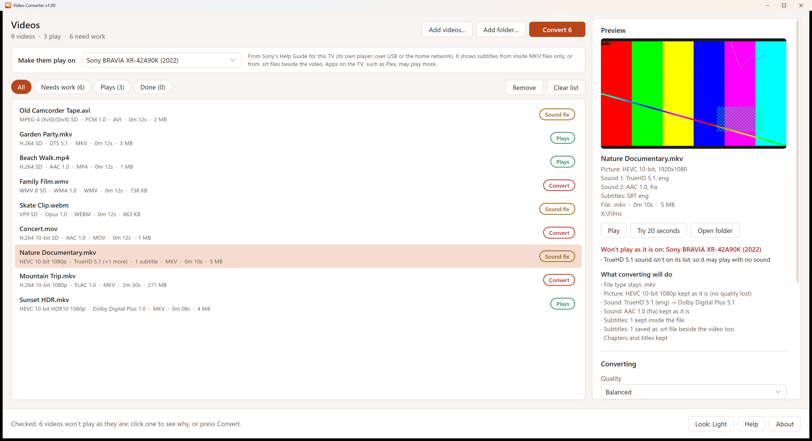
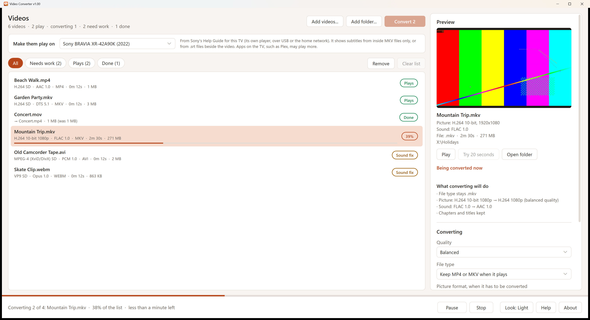
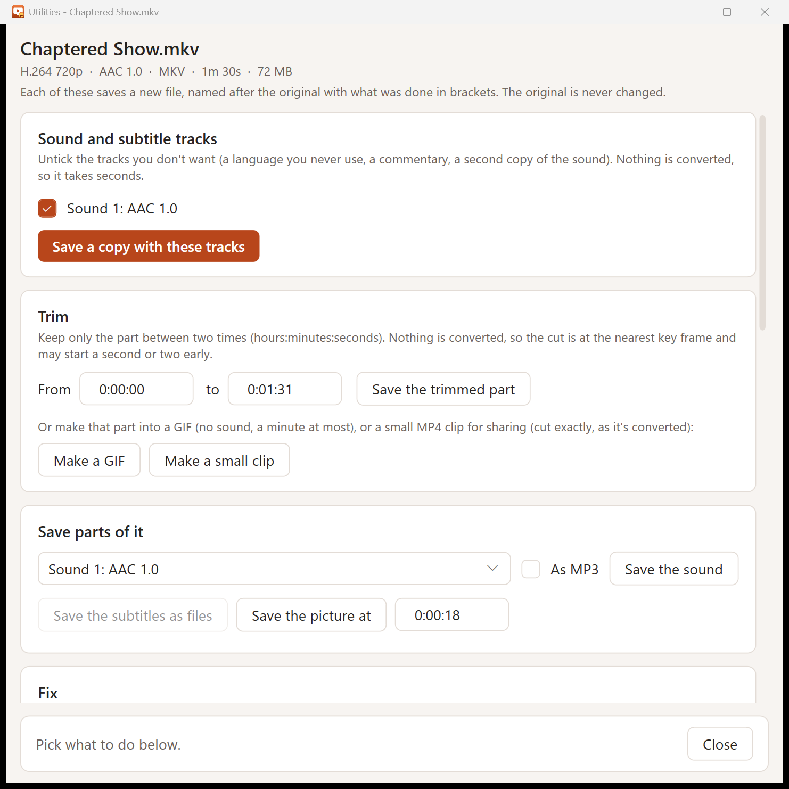

  

# Video Converter

Check which videos will play on your TV, phone or media server, and convert only the ones that won't.

    

## ✨ Features

Video Converter is a PowerShell/WPF tool that uses FFmpeg to check your videos against what a TV or device plays, and fixes only what's wrong.

- **Check first**: drop in videos or whole folders and each one is marked **Plays**, **Quick fix**, **Sound fix**, **Convert** or **Can't read**, with the reasons in plain words (".avi files aren't on its list", "DTS sound isn't on its list, so it may play with no sound", "10-bit H.264 hardly ever plays").
- **Pick what they should play on**: the Sony BRAVIA XR-42A90K (from Sony's own list for that TV) to begin with, or a Samsung or LG TV, any 4K smart TV, an older HD TV, phones and tablets, Plex/Jellyfin/Emby direct play, or your own choice of file type, picture format, sound and largest size.
- **Convert only what's needed**: when the picture already plays it's copied across untouched (no quality lost, done in seconds) and only the sound or the file type changes. MP4 or MKV is chosen so the picture can be kept whenever possible. When the picture must be converted it becomes H.264, or HEVC for 4K and HDR.
- **Keeps what matters**: every sound track and its language, subtitles (text ones in MP4 and MKV, picture ones in MKV), chapters and titles. Text subtitles can also be saved as `.srt` files beside the video, and subtitle files already beside the original go with it.
- **HDR done right**: HDR10 and HLG stay HDR on TVs that show it; for phones, older TVs and Plex direct play the picture is turned into normal colours so it doesn't look washed out. Interlaced video is made smooth.
- **Preview**: a picture from the video, everything in it (picture, each sound track, subtitles), why it won't play and exactly what converting will do. **Try 20 seconds** converts a short piece with your choices and plays it, and tells you about how big the whole file will be.
- **Batch converting** with progress for each video and the whole list, time left, **Pause**/**Resume** and **Stop**, and a taskbar progress bar. The PC isn't allowed to sleep while it works.
- **Safe**: originals are never changed. Each new file is checked (it must be as long as the original) before anything else happens, and originals go to the Recycle Bin only if you choose that.
- **Graphics card encoding**: when a picture has to be converted it uses an NVIDIA (NVENC), Intel (Quick Sync) or AMD (AMF) encoder if one works on the PC (each is test-run when the app starts), which is several times faster. Without one it uses the processor, and if the card ever fails on a video that video is done again on the processor by itself.
- **Utilities** for one video, each saving a new file and leaving the original alone: remove sound or subtitle tracks and pick the main sound, trim, make a GIF or a small clip, fix sound that's out of step, split into parts (by time or chapters), shrink under a size for sharing, save the sound (as it is or MP3), the subtitles or a still picture, make a contact sheet (shown to you first, then saved where you choose), clean up old tapes and DVDs for a big TV, add a cover and title, make quiet sound louder, turn a sideways video and remove tags.
- **More, for the whole list**: join videos (in seconds when they match), find duplicates with the best copy first, stats (with the space saved over time), a report for Excel (CSV) or as a web page, save and reopen the list (the app itself always starts with an empty list), and convert at a set time.
- **When it's done**: copy or move each finished video to a folder (your NAS films share, say), a Windows notification and sound, and sleep or shut down when the whole list is done (with 60 seconds to cancel).
- **Choices**: quality Best, Balanced or Smaller files; save next to the original or in a folder you choose; keep the originals or send them to the Recycle Bin.
- Light, Dark or the same as Windows, Help and About.

## 🖼️ Screenshots

## 📋 Requirements

- Windows 10 or 11.
- Windows PowerShell 5.1 (built into Windows) with .NET Framework 4.7.2 or later.
- [FFmpeg](https://ffmpeg.org/) (free): `ffmpeg.exe` and `ffprobe.exe`. If it isn't found, the app offers to install it with `winget install Gyan.FFmpeg`, or you can point it at your own copy.

## 📦 Installation

1. Download `Video-Converter-v1.01.zip` from the [latest release](../../releases/latest) and unzip it wherever you like to keep it.
2. Double-click **Video Converter.cmd** in the unzipped folder. It makes a **Video Converter** shortcut there and in the Start menu, and starts the tool. From then on, use the shortcut, the Start menu or a pinned taskbar button.

Nothing is installed and no Windows settings are changed. The shortcut runs the script with PowerShell's execution policy bypassed for that run only.

**From the repo:** clone it and double-click **Start Video Converter.cmd**.

### Why no exe

Home tools used to ship as PS2EXE exes, and antivirus programs (ESET among them) kept flagging those exes as generic trojans by mistake. A plain script and a shortcut give the same one-click start without the false alarms, and you can read exactly what runs.

### Build a release

Double-click **Build.cmd** in the repo folder. It reads `build.json`, checks every script for syntax errors and that `$script:AppVersion` matches the newest `CHANGELOG.md` entry, runs PSScriptAnalyzer if it's installed, copies the release files into `..\Builds\Video Converter v<version>\`, zips that folder for the GitHub release, refreshes `..\Builds\Video Converter.lnk` (what the Home Launcher starts) and scans the result with ESET's command-line scanner if it's installed.

## 🚀 Usage

1. Start Video Converter. If FFmpeg isn't found, press **Install FFmpeg** (or **Choose ffmpeg.exe...**), then **Look again**.
2. Under **Make them play on**, pick your TV or device. The line beside it says where its list comes from.
3. Drop videos or folders onto the window, or use **Add videos...** and **Add folder...** (folders inside folders are searched too).
4. Click a video to see its picture, what's in it, why it won't play and what converting will do. **Try 20 seconds** to check the result first.
5. For other jobs on one video (remove a sound track, trim, save the sound or subtitles, make it louder, turn it), click it and press **Utilities...**.
6. Set the quality, where the new files go and what happens to the originals on the right, then press **Convert**.

| Mark | Meaning |
| --- | --- |
| Plays | Should play as it is. Nothing to do. |
| Quick fix | Only the file type changes (the same picture and sound in a new file). Takes seconds. |
| Sound fix | The picture is copied untouched and only the sound is converted. |
| Convert | The picture has to be converted too. Takes a while, longer for 4K. |
| Can't read | Damaged, or not a video. |

Help in the app explains every choice.

### About the TV lists

The Sony BRAVIA XR-42A90K list is taken line by line from Sony's [Help Guide for that TV](https://helpguide.sony.net/tv/jaep1/v1/en/04-01-03_03.html) (its own player, over USB or the home network); apps on the TV, such as Plex, may play more. The Samsung, LG and other lists are general guides from the makers' published lists, so check them against your own model's manual. **My own choice** checks against exactly the file type, picture, sound and size you pick.

## ⚙️ Configuration

**Where settings live:** everything Video Converter stores is in `%APPDATA%\Video Converter\` (`settings.json` and a log). It stays on your PC and is never inside the repo or the `Builds\` folder, so rebuilding or updating can't touch it. Preview pictures and 20-second samples go in `%TEMP%\Video Converter\`; preview pictures over a week old are tidied away.

Everything is set in the app: the target, quality, file type, picture format, where new files go, the originals, `.srt` files and which FFmpeg to use.

## 📝 Changelog

See [CHANGELOG.md](CHANGELOG.md).

## 📄 Licence

[MIT](LICENSE). Copyright (c) 2026 Jason Rhodes.

Created by Jason Rhodes, built with Claude (Anthropic).
